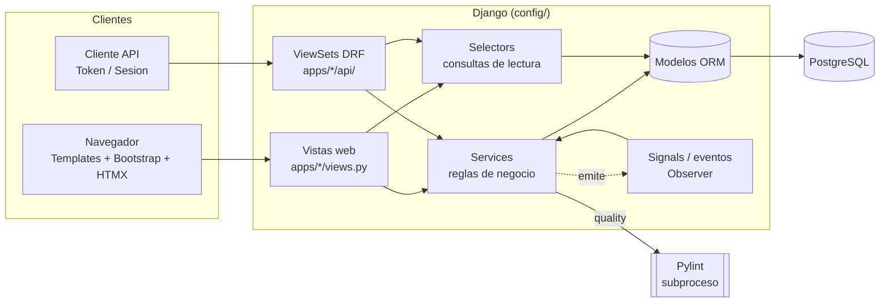
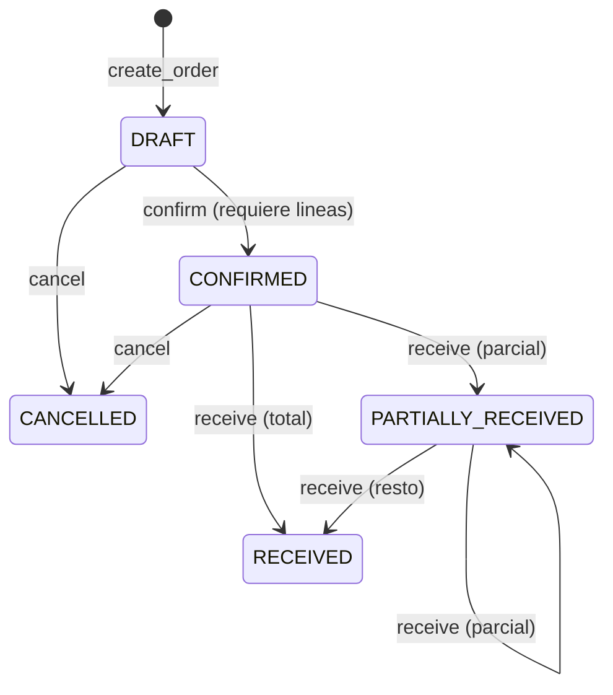

# Arquitectura de StockFlow

Documento de referencia de la arquitectura interna. Los diagramas de clases y
paquetes generados con `pyreverse` estan en [`docs/uml/`](uml/) (`make uml`).

## 1. Vista general

## 2. Capas y responsabilidades

| Capa | Ubicacion | Responsabilidad | Prohibido |
|------|-----------|-----------------|-----------|
| Presentacion web | `apps/*/views.py`, `templates/` | Validar entrada (forms), llamar services, renderizar | Logica de negocio, escribir en el ORM salvo CRUD trivial |
| Presentacion API | `apps/*/api/` | Serializers de entrada/salida, permisos por accion | Logica de negocio |
| Servicios | `apps/*/services.py`, `apps/inventory/services/` | Reglas de negocio, transacciones, transiciones de estado | Conocer HTTP / request |
| Selectores | `apps/*/selectors.py` | Consultas de lectura reutilizables (kardex, KPIs) | Escribir datos |
| Dominio | `apps/*/models.py` | Estructura, constraints, propiedades derivadas | Orquestar procesos |
| Infraestructura | `apps/core/` | Modelos abstractos, secuencias, state machine, menu, mixins | Depender de apps de dominio en import |

Regla de oro: **el stock solo cambia a traves de `InventoryService`**. Compras,
ventas, conteos y el seed llaman a ese facade; nunca tocan `Stock` directamente.

## 3. Apps

| App | Proposito | Piezas clave |
|-----|-----------|--------------|
| `core` | Infraestructura compartida | `TimeStampedModel`, `UserStampedModel`, `ActivatableModel`, `DocumentSequence`/`next_code`, `StateMachine`, `MenuRegistry`, `ServiceActionView`, `seed_demo` |
| `accounts` | Usuarios y roles | `User`, `Role`, `ROLE_PERMISSIONS`, `setup_roles`, `assign_role` |
| `catalog` | Productos y clasificacion | `Product` (FIFO/FEFO, lotes, caducidad), `Category`, `Brand`, `UnitOfMeasure` |
| `warehouses` | Almacenes y ubicaciones | `create_warehouse` crea REC/ALM-01/DES/CUA |
| `partners` | Proveedores y clientes | `Supplier`, `Customer` |
| `inventory` | Nucleo de stock | Commands, `InventoryService`, estrategias, `CycleCountService`, `AlertService`, kardex |
| `purchasing` | Ordenes de compra | `PurchaseService` (confirmar, recibir parcial/total, cancelar) |
| `sales` | Ordenes de venta | `SalesService` (confirmar, picking sugerido, despachar) |
| `reports` | KPIs y exportaciones | `dashboard_kpis`, exporters CSV/XLSX/PDF |
| `audit` | Bitacora | Registro de modelos auditados + receivers de modelos y sesiones |
| `quality` | Modulo Pylint | Runner (subproceso), parser json2, catalogo, `LintService`, comandos `run_pylint` y `generate_uml` |

## 4. Patrones de diseno

| Patron | Donde | Por que |
|--------|-------|---------|
| Command | `inventory/services/commands.py` (`ReceiveStockCommand`, `IssueStockCommand`, `TransferStockCommand`, `AdjustStockCommand`) | Cada movimiento valida, actualiza `Stock` y registra `StockMovement` de forma atomica y aislada |
| Facade | `inventory/services/inventory_service.py` | API unica para el resto de apps; emite `stock_changed` tras cada comando |
| Strategy | `inventory/services/strategies.py` (FIFO / FEFO), `reports/exporters.py` (CSV / XLSX / PDF) | Algoritmos intercambiables seleccionados por configuracion |
| Factory | `get_strategy()`, `get_exporter()` | Desacopla el llamador de la clase concreta |
| State | `core/state.py` + `ORDER_TRANSITIONS`, `CYCLE_COUNT_TRANSITIONS` | Transiciones validas declarativas; las invalidas lanzan `InvalidStateTransitionError` |
| Observer | `inventory/events.py` + `signals.py` (alertas), `audit/signals.py` (bitacora) | Efectos secundarios sin acoplar el emisor |
| Registry | `core/menu.py` (`MenuRegistry`), `audit/registry.py` | Cada app se registra en `ready()` sin que `core` la conozca |
| Adapter | `quality/runner.py` (`SubprocessPylintRunner`) | Envuelve el CLI de Pylint detras del protocolo `LintRunner` |
| Template Method | `core/views.py` (`ServiceActionView.perform`), `_MovementCreateView.get_service_kwargs` | Flujo comun (permisos, errores, mensajes) con un paso variable |
| DTO | `ReceiptLineInput`, `ShipLineInput`, `KardexRow`, `TabularData`, `LintResult` | Datos inmutables entre capas |
| Dependency Injection | `PurchaseService(inventory=...)`, `LintService(runner=..., parser=...)` | Tests con dobles sin parchear modulos |

## 5. Principios SOLID aplicados

- **S**: services, selectors, serializers y vistas tienen una sola razon de cambio.
- **O**: nuevas estrategias de rotacion o exportadores se agregan registrandolos, sin tocar a los llamadores.
- **L**: `FIFOStrategy`/`FEFOStrategy` y los exporters son sustituibles via su protocolo.
- **I**: `LintRunner` y `AllocationStrategy` son protocolos minimos (un metodo).
- **D**: `LintService` y `PurchaseService` dependen de abstracciones inyectables.

## 6. Flujos principales

### Compra (OC)

Cada recepcion llama `InventoryService.receive`, que recalcula el **costo
promedio ponderado** sobre toda la existencia del producto.

### Venta (OV)

`DRAFT -> CONFIRMED -> PARTIALLY_SHIPPED -> SHIPPED` (o `CANCELLED`). El picking
sugerido usa la estrategia del producto: **FEFO** ordena por vencimiento y
excluye lotes vencidos y la ubicacion de cuarentena; **FIFO** por antiguedad.

### Conteo ciclico

`DRAFT -> IN_PROGRESS -> APPROVED` (o `CANCELLED`). Al crearse toma un snapshot
de las existencias; la aprobacion (permiso `accounts.approve_cyclecount`)
genera un ajuste por cada diferencia.

## 7. Seguridad y permisos

- Permisos por modelo de Django agrupados por rol (`accounts/roles.py`);
  `setup_roles` sincroniza los `Group` y `assign_role` asigna el grupo al usuario.
- Permisos custom (`confirm_*`, `receive_purchaseorder`, `ship_salesorder`,
  `approve_cyclecount`, `view_kardex`, `run_lint`) viven en `accounts` (modelo
  `CustomPermissions`), por eso se referencian como `accounts.<codename>`.
- API: `ModelPermissions` exige tambien `view_*` en lecturas y aplica
  `action_permissions` en acciones; `DELETE` es desactivacion logica.
- Errores de dominio (`DomainError`) y de validacion se convierten en HTTP 400
  (`core/api/exceptions.py`) y en mensajes de UI (`ServiceActionView`).

## 8. Como agregar una app nueva

1. `python manage.py startapp <nombre> apps/<nombre>` y ajustar `apps.py` (`name = "apps.<nombre>"`).
2. Crear `models.py`, `services.py`, `selectors.py`, `views.py`, `urls.py`, `api/` y `tests/` siguiendo el patron de las apps existentes.
3. Registrar la app en `INSTALLED_APPS` y sus URLs en `config/urls.py` / `config/api_urls.py`.
4. `python manage.py makemigrations <nombre>` (el test `tests/test_migrations.py` falla si se olvida).
5. Registrar el menu en `AppConfig.ready()` con `MenuRegistry` y, si aplica, la auditoria con `audit.registry.register`.
6. Agregar los permisos al rol correspondiente en `accounts/roles.py` y correr `setup_roles`.
7. `make check` (check, migraciones, Pylint, tests).
